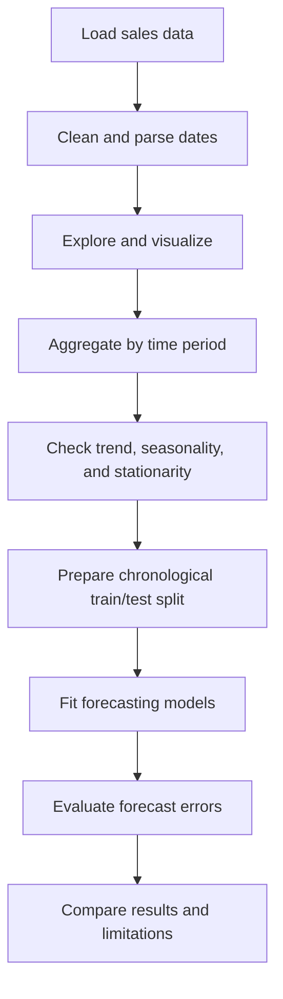

::: {align="center"}
# 📈 Time Series Analysis with Statistical Models

### Explore trends. Understand seasonality. Build forecasting intuition.

A practical Python notebook project exploring time-series analysis and
forecasting concepts using retail sales data and statistical /
machine-learning techniques.

[](https://www.python.org/)
[](https://jupyter.org/)
[](https://pandas.pydata.org/)
[](https://www.statsmodels.org/)
[](https://scikit-learn.org/)
:::

------------------------------------------------------------------------

## 📌 Project Overview

Time-series analysis studies observations recorded over time to identify
trends, seasonal patterns, and changes in behavior. This project uses
Python notebooks to explore these ideas with sales data and statistical
forecasting methods.

The notebooks demonstrate data preparation, time-based aggregation,
visualization, stationarity testing, differencing, decomposition, and
forecasting approaches. The project is intended for learning and
experimentation; model performance should be evaluated on a clearly
defined test period before using forecasts for decisions.

## 🎯 Objectives

-   Prepare date-based data for time-series analysis.
-   Visualize sales over time and aggregate sales by month.
-   Explore trend, seasonality, and non-stationary behavior.
-   Apply the Augmented Dickey--Fuller (ADF) test.
-   Understand regular and seasonal differencing.
-   Experiment with forecasting methods and compare prediction errors.

## 🗂️ Notebooks

  ----------------------------------------------------------------------------------------------------------------------------------------------------------------------------------------------------
  Notebook                                     Focus                   Open
  -------------------------------------------- ----------------------- -------------------------------------------------------------------------------------------------------------------------------
  **Time_Series_Analysis.ipynb**               Sales data exploration, [View
                                               product/customer        notebook](https://github.com/mdaamir6870/Time-Series-Analysis-with-Statistical-Model/blob/main/Time_Series_Analysis.ipynb)
                                               analysis, time-based    
                                               aggregation,            
                                               visualizations, and     
                                               forecasting concepts    

  \*\*Time\_\_Series\_\_\_Analysis.ipynb\*\*   Additional time-series  [View
                                               experiments,            notebook](https://github.com/mdaamir6870/Time-Series-Analysis-with-Statistical-Model/blob/main/Time__Series___Analysis.ipynb)
                                               stationarity,           
                                               decomposition,          
                                               differencing, and       
                                               forecasting methods     
  ----------------------------------------------------------------------------------------------------------------------------------------------------------------------------------------------------

### 🚀 Open in Google Colab

Run the notebooks in your browser without installing Python locally.

-   [](https://colab.research.google.com/github/mdaamir6870/Time-Series-Analysis-with-Statistical-Model/blob/main/Time_Series_Analysis.ipynb)
    **Time Series Analysis**
-   [](https://colab.research.google.com/github/mdaamir6870/Time-Series-Analysis-with-Statistical-Model/blob/main/Time__Series___Analysis.ipynb)
    **Additional Analysis**

> **Dataset required:** The notebooks refer to
> `Sample - Superstore.csv`. This file was not included in the uploaded
> project archive. Add the dataset to the project root (or update the
> file path in the notebook) before running cells that load it.

## 🧰 Tools & Libraries

  -----------------------------------------------------------------------
  Library                             Use
  ----------------------------------- -----------------------------------
  **Pandas**                          Data loading, cleaning, date
                                      handling, and aggregation

  **NumPy**                           Numerical operations and sample
                                      trend construction

  **Matplotlib**                      Time-series plots and forecast
                                      visualization

  **Seaborn**                         Exploratory and categorical data
                                      visualization

  **Statsmodels**                     Seasonal decomposition, ADF
                                      testing, ARIMA/SARIMAX, and
                                      exponential smoothing

  **Scikit-learn**                    Train/test splitting, regression
                                      models, and evaluation metrics
  -----------------------------------------------------------------------

## 🔍 Concepts Explored

### 1. Data preparation and exploration

-   Load and inspect tabular sales data.
-   Parse order and shipping dates.
-   Handle invalid date values and explore summary statistics.
-   Analyze products, categories, customers, and shipping patterns.

### 2. Time-series visualization

-   Plot sales against order date.
-   Aggregate sales by year and month.
-   Observe possible long-term trends and recurring patterns.

### 3. Trend, seasonality, and stationarity

-   Understand the components of a time series.
-   Explore seasonal decomposition.
-   Test stationarity using the Augmented Dickey--Fuller test.
-   Apply regular and seasonal differencing where appropriate.

### 4. Forecasting experiments

The notebooks explore methods such as: - ARIMA - SARIMAX - Exponential
Smoothing - Linear Regression - Random Forest Regression

These methods have different assumptions and strengths. Their
suitability depends on data frequency, available history, seasonality,
and the validation strategy.

### 5. Model evaluation

-   Explore Mean Squared Error (MSE) and Root Mean Squared Error (RMSE).
-   Use a chronological train/test split for forecasting tasks.
-   Compare predictions with observed values.

**Important:** Avoid random shuffling for time-series evaluation. Fit
preprocessing and models using training data only, then evaluate on
later observations to reduce data leakage.

## ⚙️ Getting Started

### 1. Clone the repository

``` bash
git clone https://github.com/mdaamir6870/Time-Series-Analysis-with-Statistical-Model.git
cd Time-Series-Analysis-with-Statistical-Model
```

### 2. Create a virtual environment

**Windows PowerShell**

``` powershell
python -m venv .venv
.\.venv\Scripts\Activate.ps1
```

**macOS / Linux**

``` bash
python3 -m venv .venv
source .venv/bin/activate
```

### 3. Install dependencies

``` bash
python -m pip install pandas numpy matplotlib seaborn statsmodels scikit-learn jupyter
```

### 4. Add the dataset

Place `Sample - Superstore.csv` in the repository root, or update the
dataset path in the relevant notebook to match your file location.

### 5. Start Jupyter Notebook

``` bash
jupyter notebook
```

Open a notebook and run the cells from top to bottom.

## 🧪 Recommended Workflow



## 📊 Potential Improvements

-   Add a `requirements.txt` file for reproducible installation.
-   Include the dataset source and data dictionary.
-   Add a consistent chronological validation strategy.
-   Compare models using MAE, RMSE, and MAPE where appropriate.
-   Include forecast plots with confidence intervals where supported.
-   Document final model parameters and measured results.
-   Remove duplicate notebook content or clearly label each notebook's
    purpose.

## 👨‍💻 Author

**Md Aamir**\
*MSc Data Science \| Data Analytics \| Machine Learning & Generative AI*

-   GitHub: [@mdaamir6870](https://github.com/mdaamir6870)

## 🤝 Feedback & Contributions

Suggestions and improvements are welcome. Open an issue to report a
problem or submit a pull request with a useful enhancement.

If you find this project helpful, consider giving the repository a ⭐.

------------------------------------------------------------------------

::: {align="center"}
**Analyze • Model • Forecast • Learn**
:::
